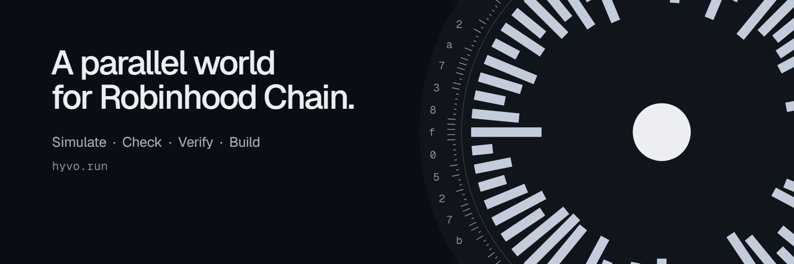

  

# Hyvo

A parallel world for Robinhood Chain.

Put a token launch, a rumor or a listing in front of a crowd of AI traders on a private fork of Robinhood Chain, and
watch them post and trade, round by round. Every run is one file whose hash is committed on-chain, so anyone can check
that nobody changed it since.

- **Site:** [hyvo.run](https://hyvo.run)
- **X:** [@Hyvorun](https://x.com/Hyvorun)
- **Code:** [hyvorun/hyvo](https://github.com/hyvorun/hyvo)

Results are synthetic crowd reactions, not trading signals. Nothing here is financial advice.

**Official accounts:** only hyvo.run and @Hyvorun. Hyvo never sends the first DM, and never asks for a seed phrase or
a private key.
